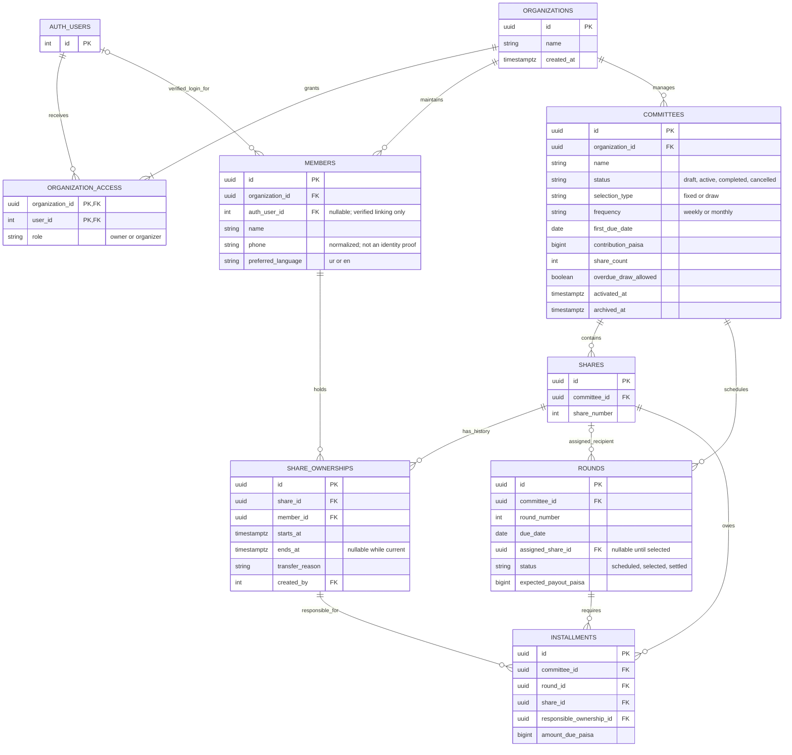
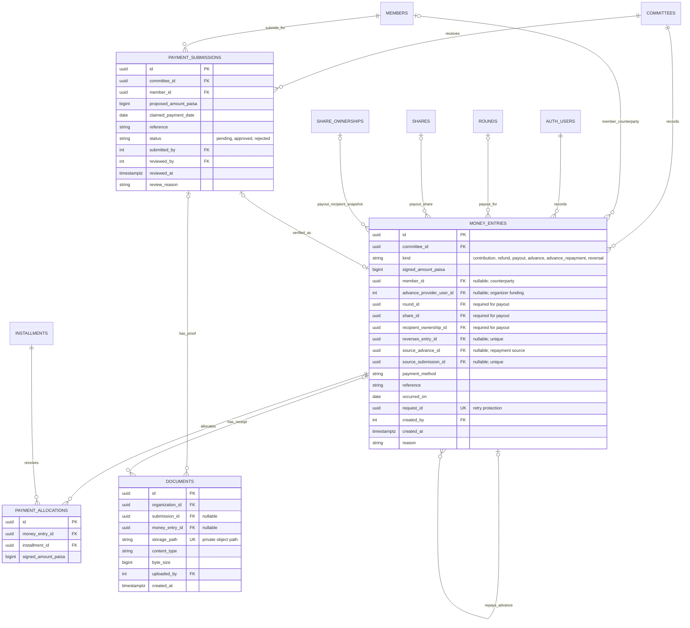
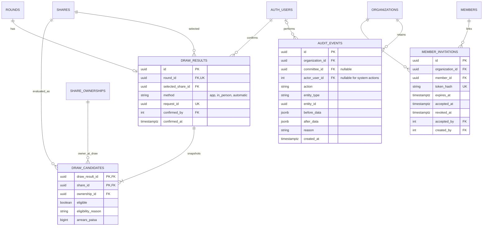
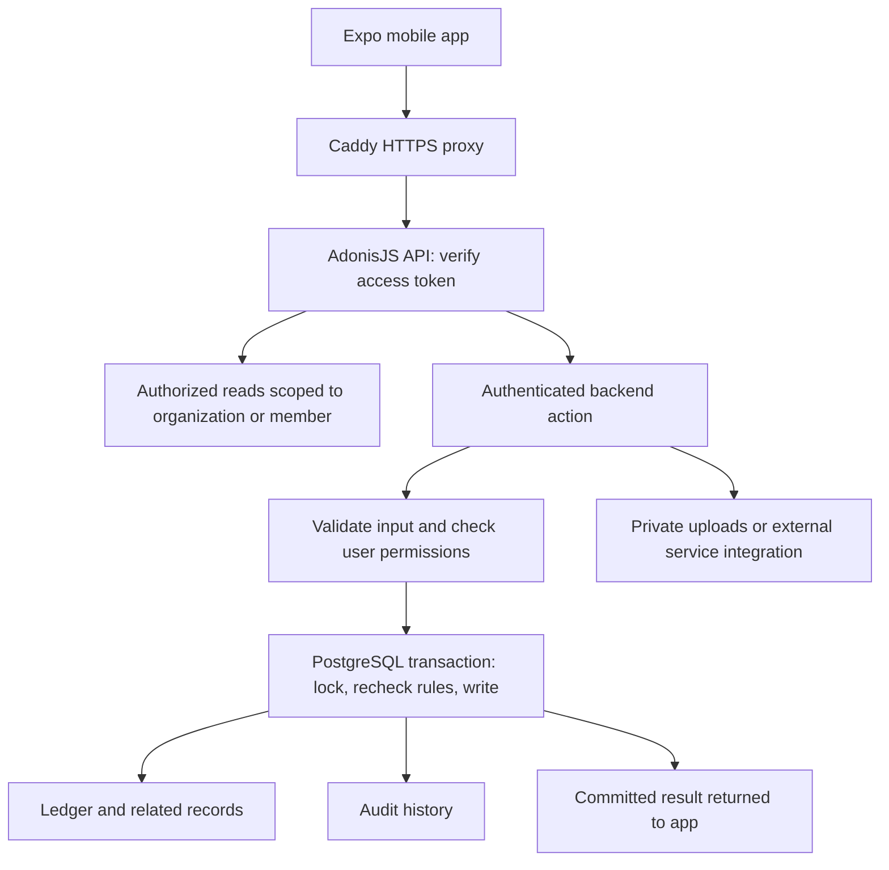

# Committee Manager — ERD and Backend Actions

Proposed database design for [PLAN.md](./PLAN.md). These Mermaid diagrams describe the design; they are not implemented migrations. See [README.md](./README.md) for the current scaffold.

Amounts are integer paisa in PostgreSQL `bigint`. Financial calculations must preserve integer precision in backend and mobile code. Domain IDs are UUIDs; the starter authentication users use integer IDs. Event timestamps are timezone-aware, and installment due dates are local calendar dates.

## 1. Accounts, committees, and shares

An organization is one organizer's workspace. Additional organizers can be granted access to that workspace. A member is a contact record, which can be linked to a verified login later. Shares belong to committees; ownership history supports replacements without rewriting old records. `AUTH_USERS` represents the AdonisJS `users` table. Its access-token table is omitted here. Keep the official starter's integer user IDs; references to users below are integers, while future domain records use UUIDs.

### Constraints

- Unique `(committee_id, share_number)`, `(committee_id, round_number)`, and `(round_id, share_id)`.
- A share can be assigned to at most one round in its committee. Multiple null assignments are allowed before draws.
- Every related share, round, installment, and ownership must belong to the same committee; members and committees must belong to the same organization. Enforce with composite foreign keys or controlled database functions, not UI checks alone.
- No overlapping ownership periods for a share. Activation requires exactly one current owner per share.
- Activation creates N rounds and N × N installments for N shares. All fixed-number rounds must have recipients.
- Completed rounds retain their recipient. An audited swap is allowed only between unpaid-out fixed-number rounds.
- Installment responsibility is explicit. Transfers must name which outstanding/future obligations move; they cannot silently rewrite the previous owner's debt or historical payments.

## 2. Financial records and payment proof

Use one financial ledger for actual cash movements. A positive entry increases cash held; a negative entry decreases it. Payment allocations explain which installments a receipt or refund affects. A proof submission is a request for verification, not a financial entry.

### Ledger rules

- Contributions and organizer advances are positive. Payouts, member refunds, and organizer advance repayments are negative. Reject zero amounts.
- A reversal is the exact opposite of its original entry and copies the original attribution. It reverses allocations atomically as well. One original entry can be reversed once; corrections use reversal plus replacement. A refund is an actual new outgoing movement, not a correction.
- Entries and allocations are append-only through controlled backend functions. No direct client update/delete access.
- Allocation totals cannot exceed the receipt amount. Unallocated net member receipts represent credit. Refunds reduce unallocated credit or explicitly reverse installment allocations; prevent over-refunds and over-allocation under concurrent requests.
- Positive allocation means contribution paid; negative allocation undoes that payment. Sum allocations against installments to calculate remaining obligations.
- Payout entries must reference the selected round, share, and recipient ownership. Partial payouts are allowed; net payouts cannot exceed the round's entitlement without a separately designed amendment.
- Every advance repayment references its original advance. Prevent repayments exceeding the outstanding advance, including corrections.
- Verify cash availability under a committee lock. If the organizer funds a shortfall, record the advance explicitly before or in the same transaction as the payout.
- An approved submission creates exactly one contribution entry in the same transaction. The submitter must be authorized for the member and committee.
- Request IDs are generated before submission. Reusing an ID with the same input returns the existing result; reusing it with different input is rejected.
- Each document has exactly one parent: submission or money entry. Access follows that parent's permissions, not a public storage URL.
- Cash held is the sum of signed ledger amounts. Collections, payouts, credits, advances, and arrears are separate derived totals; do not add expected installments to cash held.
- Reject a reversal that would violate existing allocations, payout entitlement, advance repayment, or cash constraints. Correct dependent records explicitly in a controlled transaction.

## 3. Draws, invitations, and history

- Lock the committee while evaluating eligibility and confirming a draw. Serialize relevant financial changes against that lock so the eligibility snapshot is coherent.
- Snapshot all not-yet-selected shares with their eligibility decision, ownership, and arrears. Pick only from eligible shares using secure backend randomness.
- Save candidate snapshots, draw result, round assignment, and audit event together. If no share qualifies, create no confirmed result.
- A selected share must appear as eligible in its snapshot. An in-person result must also pass the declared eligibility rules.
- Draw results and snapshots are immutable. Refreshing the app cannot reroll a result.
- Invitations are expiring, revocable, single-use credentials. Store a token hash, not the raw token; accept and link the account transactionally. A login cannot claim a member merely by entering their phone number.
- Audit data is written by trusted backend code or triggers. Members cannot read organization-wide audit logs. Avoid storing secrets or unnecessary personal data in snapshots.

## Backend action flow

The backend is one self-hosted Node.js/AdonisJS API with PostgreSQL, running on a paid VPS. The mobile app connects only to the API over HTTPS. We are building our own backend rather than self-hosting the Supabase platform.

| Action | Backend responsibility |
| --- | --- |
| Create/edit draft committee | Verify organizer access; validate settings and ownership |
| Activate committee | Lock settings; create schedule and installments atomically |
| Record contribution | Verify organizer; write ledger entry, allocations, and history together |
| Approve payment proof | Lock pending submission; create one verified contribution |
| Correct financial record | Verify dependencies; append reversal and any replacement atomically |
| Run/record draw | Lock committee; snapshot eligibility; select and persist one result |
| Swap fixed turns | Verify both turns remain unpaid; update both and preserve history |
| Record payout | Validate recipient, entitlement, available funds, and duplicate request ID |
| Transfer share | Preserve ownership periods; explicitly transfer agreed obligations |
| Accept invitation | Validate single-use token and link verified user to the member |
| Complete/cancel committee | Reconcile obligations, cash, credits, and advances; require explicit settlement |
| Prepare WhatsApp reminder | Authorized read of current balance; app opens share UI for organizer to send |

Implement actions as AdonisJS controllers backed by small action services. Use a Lucid managed transaction, lock the relevant records, check business rules, and commit financial records and audit history together. Use Lucid models or its query builder with bound parameters. Use a database function only when it is the smallest way to enforce a shared invariant; no separate worker or function-hosting platform is needed initially.

The app may validate forms for convenience, but the API repeats all trust-boundary checks using VineJS validators. Validate AdonisJS access tokens and organization/member permissions on every protected request. Keep PostgreSQL off the public network and deny direct mobile database access. Use a restricted runtime database role, separate migration credentials, and authorized file routes over a private upload volume. Database row-level security may be added as defense in depth; the initial design relies on tested API authorization and database constraints.

Private receipt files and database volumes must be backed up off-server. Caddy handles HTTPS, while Docker Compose manages the API, database, and proxy on one VPS. Health checks, restart policies, disk monitoring, and backup alerts are part of production readiness. One VPS remains a single point of failure.

## Implementation order and limits

1. Create organization access, committee, share, ownership, round, and installment migrations.
2. Add ledger constraints and transactional contribution/payout functions with reconciliation tests.
3. Add transactional draws and concurrent-request tests.
4. Add invitations, proof review, private documents, and member-access tests.
5. Add controlled transfers, settlement/closure actions, and restoration verification before the pilot.

This design assumes whole shares, one payout entitlement per share, fixed contribution amounts after activation, and online financial writes. Fractional shares, fees, penalties, and automated settlement rules need separate decisions before extending the schema.
