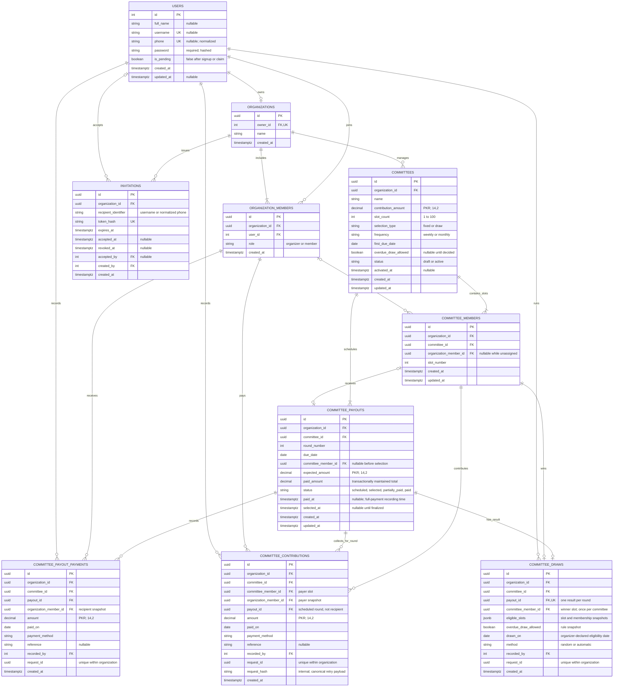

# Committee Manager — Current Database Design

The committee setup uses three tables: `committees`, `committee_members`, and `committee_payouts`. Money received is recorded in `committee_contributions`; payout handovers use `committee_payout_payments`. `committee_draws` preserves one lucky-draw result and eligibility snapshot per drawn round. Identity and organization access use the existing users, organizations, memberships, and invitations. AdonisJS's `auth_access_tokens` table is omitted from the diagram.

Domain IDs are UUIDs; user IDs are integers. All event timestamps use PostgreSQL `timestamptz` and UTC. Clients convert event timestamps to the user's timezone for display. Calendar dates remain `date` values and are never timezone-converted.

Amounts are PKR `decimal(14,2)` values, exposed as strings. Calculations use exact integer minor units internally. Contributions are limited to Rs 9,999,999,999.99 and slot counts to 100 so every expected payout fits the decimal column.

## Identity and access

- Each user must have a username or phone; either identifier is unique when supplied. Passwords and invitation/token secrets are hashed.
- An organizer signs up independently. Signup atomically creates their user, organization, and organizer membership. Each user owns at most one organization.
- Roles belong to organization memberships. A user may organize their own group and participate in others. No separate members or staff-access table exists.
- Organizers may add a name and phone before the person uses the app. The backend creates a pending user with a unique random temporary password hash and a required membership user link. Existing users are reused without altering their credentials. Pending accounts cannot authenticate; a recipient-bound invitation claim sets their password and enables login while preserving the same user and membership IDs.
- Invitation acceptance for a separately registered login creates a member membership only. Invitations are recipient-bound, expiring, revocable, and single-use. The secret is shared manually; phone ownership verification remains pending.
- Controllers resolve the organization through the authenticated user and authorize through Bouncer before passing scoped records to services.

## Slots and payout turns

A `committee_members` row is a numbered slot, not a distinct person. For example, Ahmed holding slots 1 and 3 has two rows pointing to the same organization membership. Each slot contributes every round and has one payout entitlement.

Draft creation creates N slots and N payout turns. Fixed turns initially reference the same-numbered slots; draw turns have null recipients. Every draft payout has `scheduled` status and null `selected_at`. Payout assignments live only in `committee_payouts`; member rows do not duplicate a payout-turn column.

- Unique `(committee_id, slot_number)` prevents duplicate slots.
- Unique `(committee_id, round_number)` prevents duplicate rounds.
- Unique non-null `(committee_id, committee_member_id)` prevents a slot receiving two turns. Several unselected turns may have null recipients.
- Composite foreign keys enforce that an assigned organization member belongs to the same organization and a recipient slot belongs to the same committee and organization.
- Database checks require positive amounts, valid number bounds, and consistent selection status/timestamps.
- Bulk assignment updates require every slot or round exactly once, reject foreign/duplicate recipients, and roll back on failure.

## Draft editing and activation

Member assignments and fixed turn assignments can be replaced while draft. Null assignments allow unfinished setup. Slot count or payout mode changes require clearing member assignments first. Resizing regenerates slots and payout rows; mode changes reset turn assignments. Other setting changes refresh dates and expected amounts while retaining assigned turns.

Monthly schedules calculate every date from the original anchor, so Jan 31 → Feb 29 → Mar 31 in a leap year. Weekly schedules advance seven calendar days. Expected payout equals the contribution multiplied by slot count. Each slot's total expected contribution over the full cycle is the same product.

Preview reads the stored schedule without writing. Activation requires every slot to have an organization member, every fixed turn to have a recipient slot, and draw committees to have an explicit overdue eligibility rule. Fixed turns become `selected` and receive `selected_at`; draw turns stay `scheduled` and unselected. Selection never means cash was disbursed.

Services lock the committee inside a transaction for settings, assignments, previews, and activation. Retried activation returns the existing active state without duplicating rows. Active committees reject setup edits, member replacements, and turn replacements.

## Lucky-draw results

An active draw committee may select any unselected round on the organizer's chosen day. Slots already selected for another payout are excluded even before handover. If overdue slots are disallowed, sum receipts dated on/before `drawn_on` against obligations for rounds due before that day. Future-round receipts do not settle past arrears. Due-today obligations are not overdue. Eligibility remains per slot when one person owns several slots.

Cryptographic random selection chooses among eligible slots; one eligible slot is automatic and zero blocks the action. One `committee_draws` record stores the winner, eligible slot/membership/number snapshot, rule, calendar date, actor, method, request ID, and UTC timestamp. Composite foreign keys enforce round/winner scope; uniqueness prevents multiple results per round or multiple wins per slot. JSON checks require a nonempty bounded snapshot containing the winner and a method consistent with the eligible count.

The draw insert and payout recipient/selection update share a transaction. Locks serialize draws and financial writes within a committee. Matching request retries return the stored result, and another request cannot reroll a selected round. No API update/delete routes exist. Subsequent backdated receipts do not rewrite draw history. App-generated draws are implemented; in-person result recording and correction workflows remain deferred.

## Contributions, derived obligations, and handovers

There is no stored installments table or ownership-history table. A slot owes the committee contribution for each scheduled round; those expected obligations are calculated when needed. Receiving a payout does not remove later contribution obligations.

`committee_contributions` stores actual receipts for a payer slot and scheduled round, retaining the payer membership snapshot, amount, payment date/method/reference, recording actor, and UTC creation time. Composite foreign keys enforce organization and committee scope. Request IDs are unique per organization; internal request hashes distinguish full-balance requests from explicit amounts and reject changed retries. There are no API update/delete operations.

Omitting the amount records the full remaining balance; an explicit amount supports partial collection. A committee transaction lock prevents concurrent requests from exceeding one slot/round's obligation. Receipt sums derive balances without cached totals. Dues combine slots and scheduled rounds, subtract receipts dated on or before the client-supplied `asOf` date, and report `pending`, `overdue`, or `paid`. Overdue means the due date is earlier than `asOf` and a balance remains. Partial collection retains pending/overdue status until settlement. Backdated receipts affect historical reports; reports do not reconstruct past recording-time snapshots.

Payout handovers are now recorded individually in `committee_payout_payments`. Records retain the recipient membership and recording user, amount, actual handover date, method, reference, and UTC recording time. No API update/delete operation exists. Request IDs are unique per organization, and identical retries return the original record.

Recording locks the committee and payout in that order, sums handover history, checks the cached total and remaining entitlement, then inserts the history and updates `paid_amount`, status, and `paid_at` in one transaction. Database checks keep paid totals between zero and the expected amount and require consistent status/selection/payment timestamps. Partial handovers produce `partially_paid`; reaching the entitlement produces `paid`. `paid_at` is the final recording timestamp, distinct from `paid_on`.

Cash reconciliation, credits/refunds, payment corrections, proof documents, recipient acknowledgment, in-person draws, transfers, cancellation, and committee completion remain future work. Manual contribution and handover records do not verify bank/wallet settlement or available cash. Completing a round does not automatically close the committee.

Per-committee financial summaries aggregate these existing records without another table. They report full-cycle obligations, dated receipts and handovers, overdue/pending contributions, and the signed net of recorded receipts less handovers. This net excludes organizer funding and is not verified cash held. The client supplies an `asOf` calendar date; only receipts and handovers paid on or before that date count.

See [API.md](./API.md) for endpoint contracts and [PLAN.md](./PLAN.md) for the remaining product scope.
